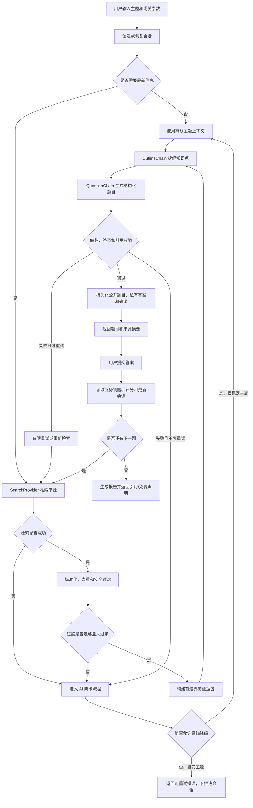

## 上下文

动机和用户可见能力请参阅 `proposal.md`。当前仓库包含 Taro 4.x/React/TypeScript 客户端和 Python FastAPI 后端。`LangChainAIService` 当前使用带有 Pydantic 结构化输出的 DeepSeek 兼容聊天模型；游戏服务负责会话状态、计分、幂等和持久化。目前没有搜索服务、证据模型、引用字段或新鲜度状态，现有 OpenSpec 仓库也没有主能力规格。

实现必须保留当前规则：AI 编排不能修改分数、生命值、会话状态或答题提交状态。同时必须保证 DeepSeek 凭据只存在于服务端。Taro 仍只用于现有微信小程序目标端。

规划时核验过的官方参考资料：

- Taro 安装和目标构建文档：https://docs.taro.zone/docs/GETTING-STARTED
- Taro 文档首页：https://docs.taro.zone/docs/
- Tavily LangChain 集成：https://docs.tavily.com/documentation/integrations/langchain
- LangChain 结构化输出指南：https://python.langchain.com/docs/how_to/structured_output/
- DeepSeek API 文档：https://api-docs.deepseek.com/

本地 Context7 连接器因认证失败不可用，因此开始实现前必须再次核对最新官方文档和已安装依赖的 API。

## 目标 / 非目标

**目标：**

- 在第一阶段 MVP 中，为易变化或明确要求最新信息的主题增加实时、基于来源的生成路径。
- 保持搜索服务可替换，并将 Tavily 作为默认配置的适配器。
- 保存来源证据、新鲜度判断和校验结果，并安全隔离公开题目与私有答案。
- 保持现有会话状态流转、计分、防重复提交、恢复行为以及稳定主题的离线降级能力不变。
- 向客户端提供足够的元数据，以展示可信引用和可重试的生成状态。
- 通过限制检索范围、限制重试次数和结构化指标，使质量与成本可观测。

**非目标：**

- 不实现通用自主 Agent、任意网页浏览或多跳研究流程。
- 不实现长文档上传/RAG、向量数据库、用户登录/VIP 权限、支付、生图、语音或社交功能。
- 不增加开放式题型；MVP 仍只包含单选题和判断题。
- 不宣称引用能够保证事实绝对正确；产品会明确展示“基于来源的 AI 内容”学习免责声明。

## 技术决策

### 1. 通过 `SearchProvider` 边界接入 Tavily

定义后端协议，接收标准化搜索请求（主题、时效提示、语言、结果数量），并返回标准化来源记录。在该边界后实现 Tavily 适配器，并通过环境配置选择具体实现。这样可以将服务商凭据、响应映射、限流逻辑和未来国内服务商隔离在游戏领域代码之外。

考虑过的替代方案：

- 在题目生成链中直接调用 Tavily：不采用，因为会耦合 Prompt 和服务商响应结构，降低降级与测试的灵活性。
- 使用模型自带联网能力：第一阶段不采用，因为不同模型和账号的可用性、引用信息和可复现性不稳定。
- 使用通用 LangChain Agent：不采用，因为 Agent 可能过度搜索、超出成本限制，而且证据来源比一次有边界的检索调用更难测试。

### 2. 在题目生成前增加明确的证据流水线

服务流程调整为：

```text
创建/恢复会话
→ 主题新鲜度分类
→ SearchProvider（策略要求时执行）
→ 标准化、去重、新鲜度/相关性/安全过滤
→ 有边界的证据包
→ OutlineChain
→ 携带证据 ID 的 QuestionChain
→ 结构化输出校验和证据声明校验
→ 持久化私有/公开题目与引用
```

证据包必须限制结果数量、摘要长度、总字符数/Token 数以及来源允许的最大年龄。每个生成声明都必须引用证据 ID，不能使用模型随意生成的 URL。来源 URL 在返回客户端前必须标准化并校验。

只有在新鲜度策略允许时，稳定主题才能使用现有离线路径。被识别为当前主题时，如果无法获得新鲜证据，必须返回可重试错误，不能静默降级为无证据的离线生成。

### 2.1 业务流程图



流程图中的关键边界如下：

- `SearchProvider`、各类 Chain 和模型只负责检索或生成候选结果，不能直接修改分数、生命值、当前题号或会话状态。
- 只有通过结构、答案、证据和安全校验的题目才能进入持久化步骤。
- `G` 节点的降级决策必须由主题新鲜度策略和错误分类共同决定，不能由模型自行决定。
- 当前主题如果没有新鲜证据，流程必须终止于可重试错误；稳定主题才允许进入离线生成路径。

### 3. 保留四条独立 Chain，并增加证据感知的结构

继续分离大纲、题目、判题和报告职责。扩展题目输出结构，增加：

- `evidence_ids` 和标准化引用记录；
- 新鲜度状态及证据检索时间；
- 用于支持答案和解析的声明或支持说明。

模型只能接收有边界的证据包，并被明确要求拒绝未经证据支持的声明。Pydantic 校验题型、选项数量/ID、答案是否属于选项、难度、引用 ID 和解析非空。随后使用确定性校验器，在持久化前检查引用 ID、来源新鲜度以及答案/解析的基本一致性。

使用当前支持的 LangChain 组合方式（`ChatPromptTemplate` 加模型结构化输出），不引入 Agent 抽象。实现阶段在核对官方结构化输出 API 后，锁定兼容的 `langchain-core`、搜索集成包以及 DeepSeek 兼容的 `langchain-openai` 版本。

### 4. 将来源追踪信息与公开题目内容分开保存

为题目记录增加基于来源的元数据，例如证据包 JSON、引用 JSON、新鲜度状态、检索时间、服务商和生成版本，同时继续将 `private_answer_json` 与 `public_content_json` 分开保存。如果数据库规范更适合规范化表，则使用以题目和来源为关联键的 `question_source` 表；服务商专属字段和受保留期限限制的原始摘要仍可使用 JSON 保存。

在日志和会话状态中增加生成尝试/关联 ID 以及稳定的失败分类。游戏事务仍负责答题提交和计分。生成失败不能增加 `current_index`、写入可作答题目或修改分数/生命值。

### 5. 扩展 API 契约，但不暴露私有证据

在 `PublicQuestion`、反馈和报告响应中增加来源摘要字段。来源摘要包含标题、发布方/域名、URL、发布日期/更新时间（如有）、检索时间和新鲜度状态；不能包含私有答案字段或不受限制的服务商原始响应。按照现有错误处理约定增加 `SEARCH_TIMEOUT`、`SEARCH_NO_EVIDENCE`、`EVIDENCE_STALE`、`EVIDENCE_UNSUPPORTED` 和 `AI_OUTPUT_INVALID` 等稳定错误。

Taro 客户端保留现有页面流程，并增加来源摘要/引用组件、生成加载状态和重试操作。API 类型必须与后端响应模型一致。客户端绝不能直接调用 Tavily 或 DeepSeek。

### 6. 限制重试、超时和成本

为搜索调用和模型调用分别设置超时；对临时故障使用小规模、可配置的重试次数和指数退避；对于无效或不安全的来源内容不重试，除非重新发起搜索。限制每道题的来源数量和证据文本量，避免将完整搜索结果集重复发送给每条 Chain，并在可用时记录服务商/模型延迟和 Token/成本元数据。

### 6.1 AI 降级策略

AI 降级采用“先保证事实依据，再保证可用性”的原则。降级不能绕过证据校验，也不能把错误结果伪装成正常题目。

#### 降级等级

| 等级 | 触发条件 | 系统行为 | 用户可见结果 |
|---|---|---|---|
| L0 正常路径 | 搜索、模型和所有校验均成功 | 使用最新证据生成题目，保存来源和新鲜度信息 | 展示题目、来源摘要和“AI 生成、基于来源”说明 |
| L1 重试当前步骤 | 搜索或模型发生临时超时、网络错误或限流，且仍有重试次数 | 按配置执行有限次数指数退避；不修改会话进度 | 展示“正在重试”，不重复扣除生命值或积分 |
| L2 重新检索 | 搜索结果为空、过期、冲突，或模型输出引用无效 | 使用调整后的查询重新检索并重新生成；丢弃未通过校验的候选题 | 展示“正在更新资料”，不展示未经验证的题目 |
| L3 稳定主题离线降级 | 主题被判定为稳定主题，且实时检索不可用或未被策略要求 | 使用现有离线模型链生成；明确记录 `offline_fallback` | 展示“当前题目未使用实时资料”的提示和 AI 免责声明 |
| L4 安全模板降级 | 稳定主题的模型调用失败，但可以使用已验证的固定题目模板/题库 | 仅使用预先审核的题目，不让模型临时编造事实 | 展示基础题目，并提示内容来自离线固定题库 |
| L5 当前主题失败 | 当前主题无法取得新鲜证据，或所有候选题均未通过校验 | 不生成题目，不推进 `current_index`，会话保持可恢复的生成失败状态 | 展示明确错误原因和“重试生成”操作 |

#### 降级触发与禁止事项

- `SEARCH_TIMEOUT`、`SEARCH_RATE_LIMITED`、模型超时等临时错误可以进入 L1；达到重试上限后再进入 L2 或 L3/L5。
- `SEARCH_NO_EVIDENCE`、`EVIDENCE_STALE`、`EVIDENCE_UNSUPPORTED` 和来源安全校验失败必须重新检索或进入 L5，不能直接使用离线模型生成当前事实题。
- `AI_OUTPUT_INVALID` 可以在不改变会话状态的前提下重试模型输出；连续失败后，稳定主题进入 L3/L4，当前主题进入 L5。
- 任何降级路径都不能暴露私有答案、完整 Prompt、API Key 或未清洗的网页原文。
- 降级产生的题目必须保存 `generation_mode`、`fallback_level`、失败分类和关联 ID，便于报告、监控和后续质量评估。

#### 会话一致性和恢复

降级过程中只允许更新生成尝试日志和临时状态，不允许更新分数、生命值、答题记录或当前题号。用户点击重试时，应复用原会话 ID 和当前题索引；成功生成后才原子地写入题目并将会话转为可作答状态。若客户端断开连接，恢复接口应返回上一次已持久化的题目或可重试的生成状态，而不是重新扣分或创建重复题目。

### 7. 使用确定性的服务商固定数据进行测试

单元测试使用假的 `SearchProvider` 和固定证据数据，验证新鲜度分类、标准化、引用强制要求、无证据声明拒绝、重试行为以及私有/公开数据隔离。现有游戏流程测试继续使用 `MockAIService`；集成测试通过可选环境变量覆盖 Tavily，但正常 CI 不能依赖真实密钥。

评测数据应包含稳定事实、近期发生变化的技术主题、相互冲突的来源、过期来源、空结果、超时、格式错误的模型 JSON 以及恶意/不可信网页文本。质量指标应报告引用覆盖率和有证据支持的题目比例，而不只是模型调用成功率。

## 风险 / 权衡

- [搜索结果过期、相互冲突或质量较低] → 要求满足新鲜度/相关性阈值，保留多个来源记录，拒绝无证据支持的声明，并展示检索时间和免责声明。
- [外部搜索增加延迟和成本] → 仅对易变化主题触发检索，限制结果/证据大小，限制重试次数，并记录服务商延迟和成本。
- [不可信网页文本尝试注入 Prompt] → 将检索文本严格作为数据处理，与系统指令隔离，清理不安全标记并限制内容大小，同时校验模型引用是否来自标准化证据 ID。
- [Tavily 可用性或价格变化] → 保留服务商协议和配置驱动的适配器；仅对策略允许的主题提供受控的服务商禁用/离线模式。
- [数据库迁移破坏已有会话] → 新来源字段使用可空或默认值，不回填历史证据，并先发布兼容读取逻辑，再启用当前主题生成。
- [引用造成虚假的确定感] → 标明内容为 AI 生成且基于来源，展示检索日期，并保留错误题目反馈和报告机制。

## 迁移计划

1. 增加配置和服务商接口以及假的服务商；先发布能够读取缺失来源字段的代码。
2. 增加可空来源字段或来源表及索引；迁移已有记录，但不重写历史题目。
3. 增加后端证据流水线和 API 字段，通过功能开关控制，先仅对内部测试主题启用。
4. 增加 Taro 来源展示、重试和错误状态；验证微信编译和真机流程。
5. 执行确定性测试和一次小范围真实服务商冒烟测试，然后为 MVP 开启当前主题路由。
6. 如果服务商不可用，则关闭功能开关或切换服务商配置；已有稳定主题的离线生成和历史会话仍可使用。由于新字段是增量字段，数据库和应用可以独立回滚。

## 待确认事项

- 具体新鲜度窗口以及来源域名白名单/黑名单可以在第一批评测数据后调整，不会改变本能力的契约。
- Tavily 套餐限制和生产环境搜索配额需要在部署配置阶段确定。
